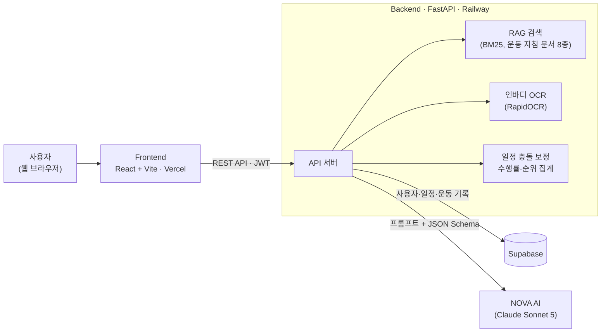

# 우왕코치 — 충북대학생을 위한 AI 운동 플래너

우왕코치는 수업·시험·아르바이트로 일정이 매주 달라지는 충북대학교 재학생을 위한 개인 맞춤형 운동 관리 서비스입니다. 사용자가 신체 정보와 운동 목표, 시간표와 운동하기 어려운 시간을 등록하면 AI가 공식 운동 지침 문서를 근거로 비어 있는 시간에 맞춘 주간 운동 계획을 추천합니다. 일정이 바뀌면 겹친 운동을 다른 빈 시간으로 옮기고, 개인의 운동 기록은 소속 단과대학의 수행률 순위에 반영되어 함께 운동할 동기를 줍니다. 이 문서는 2026 AI 우왕톤 TEAM 09(CCC 개발순)의 기획을 발표 자료와 실제 구현을 기준으로 정리한 것입니다.

## 바로가기

| 구분 | 링크 | 설명 |
| --- | --- | --- |
| Frontend | [WOOWANGTHON_TEAM_09_FE](https://github.com/woowangthon/WOOWANGTHON_TEAM_09_FE) | 화면(UI) 저장소 · React + Vite, Vercel 배포 |
| Backend | [WOOWANGTHON_TEAM_09_BE](https://github.com/woowangthon/WOOWANGTHON_TEAM_09_BE) | API 서버 저장소 · FastAPI, AI 운동 계획 생성(RAG)·인바디 OCR, Railway 배포 |
| Production | [woowangcoach.kro.kr](https://woowangcoach.kro.kr) | 배포된 서비스 · 최종 제출 폼에 제공된 테스트 계정으로 로그인하거나 회원가입 후 이용 |

## 한눈에 보기

| 항목 | 내용 |
| --- | --- |
| 대상 사용자 | 불규칙한 일정 때문에 운동 계획을 꾸준히 지키기 어렵거나, 운동을 새로 시작하고 싶지만 계획 수립과 시간 관리가 어려운 충북대학교 재학생 |
| 해결할 문제 | 시간 부족과 불규칙한 일정으로 운동 계획을 지키기 어렵고, 운동이 습관으로 이어지지 않음 |
| 해결 방법 | 시간표와 일정에서 빈 시간을 찾아 AI가 근거 문서 기반의 주간 운동 계획을 추천하고, 일정이 바뀌면 운동을 다른 빈 시간으로 옮김 |
| 차별점 | ① 일정에 맞춰 주는 AI ② 개인 수행률을 단과대학 순위에 반영하는 단과대학별 운동 참여 |
| AI 활용 | NOVA AI를 통해 Claude Sonnet 5 사용. 운동 지침 문서 8종을 RAG로 검색해 근거로 전달하고, 구조화된 출력으로 응답 형식을 강제 |
| 구현 상태 | 가입 → 정보·일정 등록 → AI 계획 → 운동 기록 → 리포트·대시보드 전 과정 배포 완료. 그룹 기능은 UI만 구현, 시간표 이미지 추출과 구글 캘린더 연동은 미구현 |

**목차** · [1. 문제 정의](#1-문제-정의) · [2. 해결 방법](#2-해결-방법) · [3. 기존 방식과의 차이](#3-기존-방식과의-차이) · [4. 우왕코치만의 차별점](#4-우왕코치만의-차별점) · [5. 주요 기능과 시연](#5-주요-기능과-시연) · [6. 서비스 구조](#6-서비스-구조) · [7. AI의 역할](#7-ai의-역할) · [8. 검증 결과](#8-검증-결과) · [9. 구현 현황](#9-구현-현황) · [10. 만들고 싶은 변화와 확장 아이디어](#10-만들고-싶은-변화와-확장-아이디어) · [11. 팀 구성](#11-팀-구성) · [부록](#부록-실행-링크와-출처)

---

## 1. 문제 정의

### 대상 사용자

- 수업·시험·아르바이트 등 불규칙한 일정 때문에 운동 계획을 꾸준히 실천하기 어려운 충북대학교 재학생
- 운동을 새로 시작하고 싶지만 운동 계획 수립과 시간 관리가 어려운 충북대학교 재학생

### 현재의 불편

- **사용자가 지금 하는 일**: 학업과 아르바이트를 병행하면서 운동 계획을 세우고 실천하려 함
- **막히는 지점**: 시간이 부족하고 일정이 불규칙해 계획을 지키기 어렵고, 운동 습관을 만들기도 어려움
- 혼자 계획을 세우면 근거가 불확실한 정보에 기대거나, 자신의 체형·운동 경력에 맞지 않는 운동을 하기 쉬움

### 확인한 근거

| 출처 | 결과 |
| --- | --- |
| 문화체육관광부, 「2025년 국민생활체육조사 결과 발표」 | 규칙적으로 체육활동을 하지 않는 이유 1위가 '체육활동 가능 시간 부족' **61.3%** |
| 충북대학교 재학생 자체 설문조사 (응답자 50명) | 학업·아르바이트 일정 때문에 운동 계획을 지키기 어려웠던 경험 **88%** · 운동 습관화의 어려움 **62%** · 운동 동기 부족 **54%** |

설문에서 드러난 원인은 크게 두 가지입니다. **일정 문제**(88%)는 '일정에 맞춰 주는 AI'로, **습관·동기 문제**(62%, 54%)는 '단과대학별 운동 참여'로 해결하는 것이 이 기획의 출발점입니다.

## 2. 해결 방법

| 단계 | 하는 일 | 세부 내용 |
| --- | --- | --- |
| 01 · 시작 | 사용자 정보 입력 | 운동 목표·경험과 신체 정보 입력, 소속 학과 입력(단과대학 자동 분류), 인바디 결과지 업로드, 시간표 등록과 생활 일정 입력, 운동하기 어려운 시간대 설정 |
| 02 · 처리 | 운동 가능 시간 분석 | 일정이 없는 요일과 시간대 계산 |
| 03 · AI의 도움 | 맞춤형 운동 계획 추천 | 운동 목표와 가용 시간에 맞는 루틴 생성, 일정이 바뀌면 대체 계획 제안 |
| 04 · 결과 | 운동 실천과 기록 | AI 추천 계획을 확인하고 승인, 운동 완료 기록과 주간 수행률 확인, 운동 기록을 단과대학별 현황에 반영 |

한 주가 끝나면 지난주 수행률을 반영해 다음 주 계획을 다시 추천받는 구조로, 계획 → 실천 → 기록 → 다음 계획이 매주 반복됩니다.

## 3. 기존 방식과의 차이

| 비교할 항목 | 기존 방식 | 우왕코치 |
| --- | --- | --- |
| 운동 계획 수립 방식 | 주간 운동 횟수·계획 기간 등을 직접 고르고 운동 루틴 확인 | AI가 운동 횟수·요일·시간·루틴을 추천하고 사용자가 승인 |
| 필요한 입력·준비 | 운동 목표·수준·주간 운동 횟수 등 설정 | 성별·나이·운동 목표·경험·인바디, 시간표·일정·운동하기 어려운 시간 등록 |
| 결과 확인 방법 | 추천 운동 루틴과 개인 운동 기록 확인 | AI 추천 계획 승인, 운동 수행률 확인, 단과대학별 운동 현황과 순위 확인 |

기존 방식은 사용자가 "언제, 몇 번" 운동할지 직접 정해야 하지만, 우왕코치는 사용자의 실제 일정에서 그 답을 찾아 제안합니다.

## 4. 우왕코치만의 차별점

### 01. 일정에 맞춰 주는 AI

갑작스러운 일정 변화에도 운동을 포기하지 않도록 대체 시간을 추천합니다.

- **작동 흐름**: 고정 일정과 운동하기 어려운 시간 등록 → 운동 가능 시간 분석 → 일정이 바뀌면 대체 시간 추천
- **계획을 만들 때**: AI가 정한 운동 시간이 일정과 겹치거나 운동 가능 시간(08:00~22:00)을 벗어나면 서버가 그날 가장 가까운 빈 시간으로 옮깁니다. 빈 시간이 없으면 그날은 휴식으로 바꾸고, 바꾼 이유를 함께 돌려줍니다.
- **일정을 추가하거나 시간표를 바꿀 때**: 겹치는 운동을 같은 날 원래 시간과 가장 가까운 빈 시간으로 옮기고, 그날 빈 시간이 없으면 이후 6일 중 운동이 없는 날로 옮깁니다. 결과는 "「하체」 운동은 오후 3:00로"처럼 안내합니다.
- **운동을 놓쳤을 때**: 놓친 운동을 오늘의 빈 시간(저녁 우선)으로 옮기자고 제안하고, 다른 빈 시간도 고를 수 있습니다.
- **계획이 마음에 들지 않을 때**: '다른 계획 추천 받기'로 그 주의 남은 계획을 이전과 다르게 다시 추천받을 수 있습니다.

### 02. 단과대학별 운동 참여

개인의 운동 수행을 단과대학 전체 수행률에 반영해 참여 동기와 지속성을 높입니다.

- **작동 흐름**: 개인 운동 기록과 수행률 집계 → 소속 단과대학 수행률에 반영 → 단과대학별 현황과 순위 확인
- **단과대학 자동 분류**: 회원가입 때 입력한 학과로 단과대학을 자동 분류합니다. 충북대학교 홈페이지의 단과대학 안내를 기준으로 88개 학과를 15개 단과대학(학과군 포함)에 연결했습니다.
- **수행률 계산**: 이번 주 소속 학생들이 완료한 운동 종목 수 ÷ 계획된 운동 종목 수. 아직 오지 않은 날의 운동은 빼서 주 중간에 수행률이 낮아 보이지 않게 했습니다.
- **순위 표시**: 수행률이 같으면 같은 순위(1, 2, 2, 4 …)로 표시하고, 운동한 학생 수를 함께 보여 줍니다. 학과를 입력하지 않은 사용자는 '기타'로 묶어 순위에서 제외합니다.

## 5. 주요 기능과 시연

**시연 영상**: <https://youtu.be/LyYPoLK7Jys> (배속 구간에는 몇 배속인지 영상에 표시되어 있습니다)

시연 순서: ① 사용자 정보와 일정 등록 → ② AI 운동 계획 추천 → ③ 일정 변경과 대체 시간 추천 → ④ 운동 기록과 단과대학 현황 → ⑤ 다음 주 운동 계획 추천

| 기능 | 내용 |
| --- | --- |
| 회원가입·초기 설정 | 학과, 운동 목표(근력·근육량 향상, 체지방 관리, 기초 체력·심폐지구력 향상 등), 운동 경험, 헬스장 이용 가능 여부, 신장·체중·나이·성별, 운동하기 어려운 시간(취침·점심 등)을 입력하고 인바디 결과지와 수업 시간표를 등록 |
| 인바디 OCR | 결과지 사진에서 키·몸무게·체지방률·골격근량·측정일을 자동으로 읽고, 사용자가 확인·수정한 뒤 저장 |
| AI 주간 운동 계획 | 이번 주 남은 날짜별로 운동 부위, 시작 시각, 종목, 세트·횟수(또는 시간)를 추천. '이 계획으로 시작하기' 또는 '다른 계획 추천 받기' 중 선택 |
| 캘린더·생활 일정 | 월간 캘린더에서 운동 일정과 생활 일정을 함께 관리하고 종목별 운동 상세를 확인. 일정을 추가하면 겹치는 운동을 빈 시간으로 옮김 |
| 운동 기록 | 운동 종목별 이수 체크 |
| 주간 리포트 | 요일별 수행률 확인. 리포트 화면에서 다음 주 계획을 만들면 지난주 요일별·시간대별 수행률이 AI에 함께 전달됨 |
| 단과대학 대시보드 | 이번 주 단과대학별 수행률 순위와 운동한 학생 수 |

## 6. 서비스 구조

### 입력부터 출력까지

- **입력**: 신장·체중·BMI, 인바디 결과, 운동 경력, 시간표 등의 일정, 그 밖에 계획에 필요한 정보
- **핵심 처리**: RAG(검색 증강 생성)로 기반 자료에서 필요한 내용을 검색한 뒤 이를 바탕으로 적절한 응답을 생성. 응답은 구조화된 출력으로 받아 부정확한 정보나 환각이 섞일 가능성을 줄임
- **저장·연결**: Supabase(사용자 정보·일정 등 데이터 관리), NOVA AI(Claude Sonnet 5 모델 호출), RapidOCR(오픈소스로 서버에서 실행)
- **출력**: 사용자 맞춤형 운동 일정, 캘린더에서 쉽게 확인하는 일정, 주간 리포트
- **오류가 생기면**: OCR로 추출한 신체 정보는 사용자가 확인한 뒤 수정할 수 있고, 요청별 로그로 오류 흐름을 추적

### AI 운동 계획이 만들어지는 과정

1. **기간 정하기**: 요청한 주의 월~일 중 이미 지난 날은 제외
2. **프로필 계산**: 저장된 나이·키·몸무게·경력으로 대상군(성인 등), BMI, 비만 단계를 서버가 계산
3. **운동 후보 고르기**: 사람이 선별한 66개 운동 목록에서 고르며, BMI 25 이상이면 고강도 운동은 제외
4. **근거 문서 검색(RAG)**: 대상군의 핵심 권장량 지침은 항상 넣고, 나머지는 한국어·영어 검색어로 BM25 검색해 관련 조각을 고름
5. **프롬프트 조립**: [참고 문서], [운동 목록], [계획 기간], [캠퍼스 일정], [지난주 운동 수행], [사용자 정보]
6. **AI 호출**: 구조화된 출력(JSON Schema)으로 계획을 받음. 운동 이름은 스키마상 목록 안의 값만 고를 수 있음
7. **검증**: 형식을 확인하고 각 운동에 부위·근육 정보를 붙임
8. **일정 보정·저장**: 일정과 겹치거나 운동 가능 시간을 벗어난 운동은 그날 가장 가까운 빈 시간으로 옮기고(없으면 휴식), 운동 일정으로 저장

### 기술 스택

| 구분 | 기술 | 역할과 선택 이유 |
| --- | --- | --- |
| Frontend | React 19, React Router, Vite · Vercel | 화면 구성과 배포 |
| Backend | Python, FastAPI · Railway | API 서버, Swagger API 문서 제공, 배포 |
| DB | Supabase | 사용자 정보, 일정, 운동 기록 저장 |
| AI | NOVA AI (Claude Sonnet 5) | 주간 운동 계획 생성. 필요한 만큼만 토큰을 소액 구매할 수 있어 불필요한 추가 구매가 없음. 같은 요청은 저장해 둔 응답을 재사용해 토큰을 아낌 |
| RAG | BM25 검색 (직접 구현) | 운동 지침 문서 8종에서 근거 조각을 검색. 외부 의존성 없이 글자 단위로 한국어·영어 문서를 함께 검색 |
| OCR | RapidOCR + PaddleOCR 한국어 모델 | 인바디 결과지 인식. 오픈소스를 서버에서 직접 실행해 외부 API 호출과 비용이 없음 |
| 인증 | Argon2id, JWT | 비밀번호 해시 저장, 로그인 토큰 발급·검증 |

## 7. AI의 역할

외부 AI인 NOVA AI를 통해 Claude Sonnet 5를 호출합니다. 판단이 필요한 계획 구성은 AI가, 정확해야 하는 계산과 일정 보정은 서버 코드가 맡도록 역할을 나눴습니다.

### AI에 전달한 것

- **사용자의 기본 정보와 일정**: 나이·성별·키·몸무게·BMI·운동 경험·목표·헬스장 이용 여부·인바디(체지방률·골격근량), 계획 기간, 캠퍼스 일정(수업·생활 일정·운동하기 어려운 시간), 지난주 운동 수행률
- **RAG 기반 자료**: WHO 신체활동 및 좌식행동 가이드라인, 한국인을 위한 신체활동 지침서 등 공문서·보고서·논문 8종에서 검색한 조각 ([전체 목록](#rag-기반-자료))
- **운동 목록**: 헬스장 기구로 할 수 있는 운동 위주로 사람이 선별·정제한 66개 운동과 부위·근육 정보. 헬스장을 이용할 수 없는 사용자에게는 기구 없이 할 수 있는 운동 위주로 고르도록 안내
- **시스템 프롬프트 규칙**
  - 참고 문서의 내용만 근거로 하고, 문서에 없는 내용은 추측하지 않음 (근거가 없으면 `found=false`로 응답)
  - 대상(성인·노인·아동·청소년 등)이 다른 내용을 섞지 않음
  - [운동 목록]에 있는 운동 이름만 그대로 사용
  - 근력 운동은 같은 부위를 다음 날 연속으로 넣지 않음 (신체활동 지침서의 "근력 운동을 한 신체 부위는 하루 이상 휴식을 취한 후 다시 하는 것이 좋습니다"에 근거)
  - 휴식하는 날에는 운동을 넣지 않음

### AI가 처리한 것과 AI가 필요한 이유

- 헬스 트레이너의 개인별 상담에는 시간과 비용이 소모됨
- 대학생의 일정은 수업·시험·과제 등으로 수시로 바뀜
- AI를 활용하면 언제 어디서든 사용자의 목표와 기본 정보로 운동 계획을 세울 수 있고, AI가 일정 없는 시간에 맞춰 계획을 짜 주므로 사용자는 빈 시간에 부담 없이 운동할 수 있음

| AI (Claude Sonnet 5)가 맡은 일 | 서버 코드가 맡은 일 |
| --- | --- |
| 요일별 운동 부위·시작 시각·종목·세트·횟수 결정 | BMI·대상군 계산, 고강도 운동 제외, 근거 문서 검색 |
| '다른 계획 추천' 요청 시 이전 계획과 다른 계획 생성 | 일정 충돌 보정, 수행률·순위 집계, 인바디 OCR |

### 결과를 확인한 방법

- 구조화된 출력(JSON Schema)으로 AI 응답 형식을 강제하고, 운동 이름은 목록 밖의 값을 고를 수 없도록 제한
- 공식 지침 문서의 근거만 사용(RAG). 검색된 근거 문서가 없으면 AI를 호출하지 않고, AI에도 근거가 없으면 계획 대신 `found=false`로 답하도록 지시
- 일정 충돌은 AI 응답을 그대로 쓰지 않고 서버가 다시 확인해 보정하며, 바꾼 내역과 이유를 응답에 기록
- 오류가 나면 HTTP 상태 코드와 요청별 구조화된 로그(JSON 한 줄, 요청 ID)로 원인을 추적하고, AI 호출마다 토큰 사용량을 기록
- 운동 목록은 사람이 직접 선별·정제

## 8. 검증 결과

| 확인 항목 | 방법·범위 | 실제 결과 | 남은 문제 |
| --- | --- | --- | --- |
| 핵심 기능 | 가입 후 로그인 → 건강 정보 → 일정 등록 → 계획 생성 → 이수 체크 → 리포트·대시보드 | 전 과정 정상 동작 | 일부 요청에서 500번대 오류와 CORS 오류가 발생하는 문제 (매우 간헐적으로 발생) |
| 일정 충돌 보정 | 기존 운동 일정과 겹치도록 일정 입력 | 겹친 운동을 그날 가장 가까운 빈 시간으로 옮기고 이동 사유 반환 | 옮길 시간을 사용자가 직접 선택할 수 없음 |
| 단과대학 대시보드 | 가짜 데이터로 순위·동점·기타 처리를 시험하고 실제 DB로 호출 | 수행률 순위, 동점 시 같은 순위, 참여 인원 모두 정상 | 실제 사용자 데이터 부족 |

## 9. 구현 현황

### 완료한 기능

- 사용자 정보·운동 목표·운동 경험 입력
- 인바디 결과지 사진 업로드와 OCR 기반 신체 정보 자동 추출
- 고정 일정과 운동하기 어려운 시간 등록
- AI 맞춤형 운동 횟수·요일·시간 추천
- 일정 변경 시 대체 운동 시간 추천
- 운동 기록과 주간 수행률 대시보드
- 학과 입력 기반 단과대학 자동 분류

### 부분 구현한 기능

- 그룹 탐색·생성·관리 UI: 서버 기능이 없어 예시 그룹으로 보여 주는 정적 구현 (직접 만든 그룹은 이용 중인 기기에만 저장되며, 단과대학 그룹의 수치만 실제 대시보드 값)
- 실제 그룹 활동·참여 데이터 연동은 미완료

### 미구현 기능

- 시간표 이미지에서 수업 일정 자동 추출 (현재는 시간표 사진을 보며 수업을 직접 입력)
- 구글 캘린더 API 연동 (화면에는 '준비 중'으로 안내)

### 다음에 확인할 것

- 실제 사진으로 OCR 인식 정확도 검증
- 실제 사용자의 사용 경험과 데이터 확보
- 서버에서 발생하는 문제(500번대 상태 코드)
- 실사용자의 서비스 경험 의견 반영

## 10. 만들고 싶은 변화와 확장 아이디어

> 우왕코치는 충북대학생의 생활에 맞춰 운동을 계획하고, 일정 변화에 대응하며, 캠퍼스 구성원과 함께 꾸준한 운동 습관을 만들어 가도록 돕는 AI 운동 동료입니다.

### 향후 확장 아이디어

| 아이디어 | 내용 |
| --- | --- |
| 01. 그룹별 공동 목표 | 구성원 간 운동 목표 공유와 그룹 챌린지를 통한 공동 목표 달성 |
| 02. 운동 미수행 원인 분석 | 운동 미수행 사유를 수집·분석해 개인별 방해 요인을 파악하고, AI가 맞춤형으로 운동 계획을 조정 |
| 03. 공강 기반 운동 친구 매칭 | 친구 추가와 공강·운동 가능 시간 공유를 통해 AI가 함께 운동할 시간대와 약속을 추천 |

## 11. 팀 구성

TEAM 09 · CCC 개발순은 아래 다섯 명이 함께 만들었습니다.

| 이름 | 역할 | 담당 |
| --- | --- | --- |
| 최동하 | 팀장, BE | AI를 사용한 API 서버 개발, 팀 운영 |
| 곽예찬 | FE | 화면 구현과 백엔드 연동 |
| 홍승표 | 발표 | 발표 영상 제작·편집과 발표 |
| 김세린 | 디자인 | 화면 구도 설정과 디자인 |
| 배수민 | 기획 | 기획안 선정과 구체화, MVP 설정 |

---

## 부록. 실행 링크와 출처

### 실행 링크와 접근 방법

| 자료 | 링크 | 열어 볼 때 확인할 것 |
| --- | --- | --- |
| 배포·실행 | <https://woowangcoach.kro.kr> | 최종 제출 폼에 제공된 테스트 계정으로 로그인하거나 회원가입하여 진행 |
| 시연 영상 | <https://youtu.be/LyYPoLK7Jys> | 배속 구간에는 몇 배속인지 영상에 표시 |
| 대표 GitHub | <https://github.com/woowangthon/WOOWANGTHON_TEAM_09_DOCS> | 팀의 전체 기획 문서 (이 문서) |
| 팀 Notion | <https://app.notion.com/p/2026-CCC-401d782a1ee38048a66ec39d1625db9f> | 회의록과 팀의 진행 상황 |
| API 문서 | <https://woowangthonteam09be-production.up.railway.app/docs> | 백엔드 API 명세 (Swagger) |

### 사용한 오픈소스

| 이름 | 버전 | 사용 범위 | 라이선스 |
| --- | --- | --- | --- |
| [RapidOCR](https://github.com/RapidAI/RapidOCR) | 3.10.0 | 인바디 결과지 정보 추출 (OCR) | Apache-2.0 |
| [PaddleOCR 모델](https://github.com/PaddlePaddle/PaddleOCR) | PP-OCRv6 글자 위치 검출, PP-OCRv5 한국어 글자 인식 | RapidOCR이 사용하는 OCR 모델 | Apache-2.0 |
| [ONNX Runtime](https://onnxruntime.ai) | 1.31.1 | OCR 모델 실행 (CPU) | MIT |
| [FastAPI](https://github.com/fastapi/fastapi) | 0.162.0 | API 서버, Swagger 문서 | MIT |
| [supabase-py](https://github.com/supabase/supabase-py) | 2.34.1 | Supabase(DB) 접근 | MIT |
| [OpenAI Python SDK](https://github.com/openai/openai-python) | 3.46.0 | NOVA AI 호출 (OpenAI 호환 API) | Apache-2.0 |
| [React](https://github.com/facebook/react) | 19.3.1 | 화면(UI) 구성 | MIT |
| [React Router](https://github.com/remix-run/react-router) | 8.5.1 | 화면 이동(라우팅) | MIT |
| [Vite](https://github.com/vitejs/vite) | 8.3.6 | 프론트엔드 개발 서버·빌드 | MIT |

### RAG 기반 자료

| 문서 | 출처 | 라이선스·이용 조건 |
| --- | --- | --- |
| WHO 신체활동 및 좌식행동 가이드라인 | 세계보건기구(WHO), 2020 (한국어판) | CC BY-NC-SA 3.0 IGO |
| 신체활동 지침서 (한국인을 위한 신체활동 지침서 개정판) | 보건복지부·한국건강증진개발원, 2023 | 공공기관 발행물 (라이선스 명시 없음) |
| 한국인을 위한 달리기 가이드라인 | 보건복지부·한국건강증진개발원, 2022 | 공공기관 발행물 (라이선스 명시 없음) |
| 성인을 위한 신체활동 가이드라인 및 운동 강도에 대한 고찰 | 박동호·김창선·김광준, 운동과학 24(2): 99-107, 2015 (doi:10.15857/ksep.2015.24.2.99) | CC BY-NC 4.0 |
| 2022 Clinical Practice Guidelines for Obesity Management in Korea | 대한비만학회, J Obes Metab Syndr 32: 1-24, 2023 | CC BY-NC 4.0 |
| 비만 | 질병관리청 국가건강정보포털 ([링크](https://health.kdca.go.kr/healthinfo/biz/health/gnrlzHealthInfo/gnrlzHealthInfo/gnrlzHealthInfoView.do?cntnts_sn=6694)) | 공공누리 제4유형 (출처표시·상업용금지·변경금지) |
| 운동 | 질병관리청 국가건강정보포털 ([링크](https://health.kdca.go.kr/healthinfo/biz/health/gnrlzHealthInfo/gnrlzHealthInfo/gnrlzHealthInfoView.do?cntnts_sn=5293)) | 공공누리 제4유형 (출처표시·상업용금지·변경금지) |
| American College of Sports Medicine Position Stand: Resistance Training Prescription | ACSM (Currier 외), Med Sci Sports Exerc 58(4): 851-872, 2026 | CC BY-NC-ND 4.0 |

- 비영리 라이선스(CC BY-NC 계열, 공공누리 제4유형) 문서가 포함되어 있어, 교내 대회용 비영리 목적으로만 사용합니다.
- WHO 가이드라인 한국어판은 세계보건기구(WHO)가 제작한 번역물이 아니며, WHO는 번역물의 내용이나 정확성에 책임지지 않습니다. 영문판 원본이 진본입니다.
- 원문 PDF와 전처리 과정은 [Backend 저장소](https://github.com/woowangthon/WOOWANGTHON_TEAM_09_BE)에서 확인할 수 있습니다.
